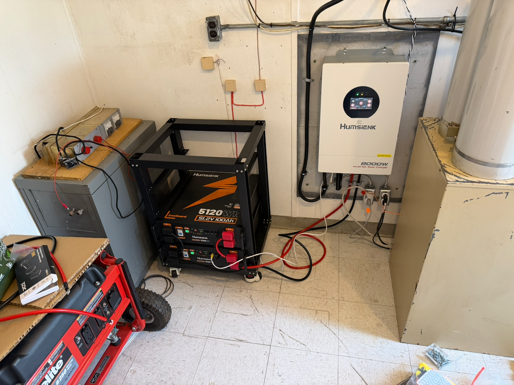
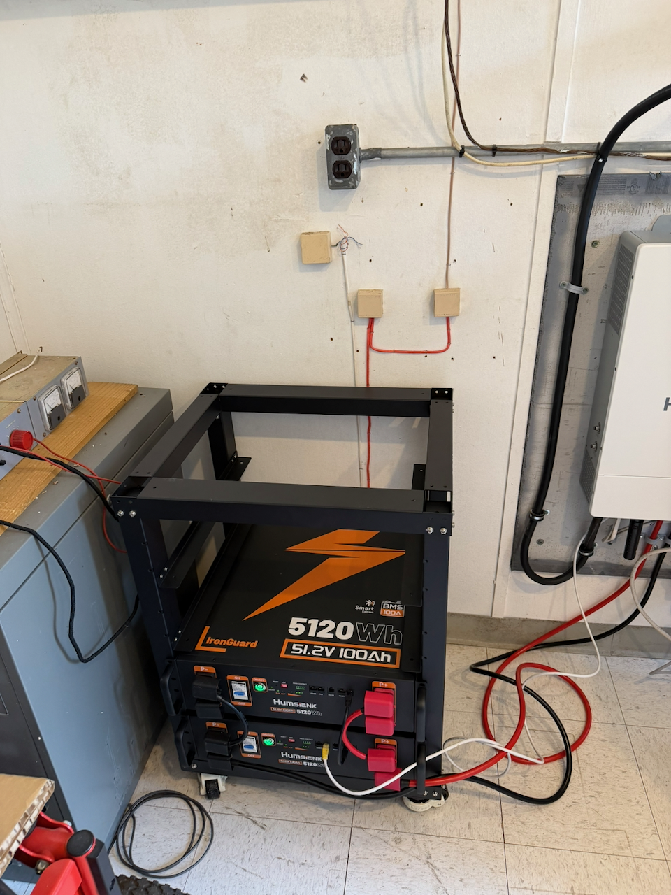

---
title: "Powering Through: AARC Completes Major Backup Power Upgrade at J.J. Pickle"
slug: "jj-pickle-repeater-power-upgrade"
date: 2026-11-11
draft: false
description: "AARC upgrades the J.J. Pickle repeater site with 200 Ah of battery backup, providing an estimated seven days of emergency communications capability for three repeaters."
tags:
  - AARC
  - Repeaters
  - Emergency Communications
  - EmComm
  - Infrastructure
  - J.J. Pickle
categories:
  - Club News
  - Infrastructure
---

**Seven days of backup power. Three critical repeaters. One more step toward a stronger, more resilient amateur radio network for Central Texas.**

The Austin Amateur Radio Club (AARC) is proud to announce the completion of a significant power infrastructure upgrade at our **J.J. Pickle Research Campus repeater site**, strengthening our ability to provide reliable communications to amateur radio operators and the greater Austin community.

This investment is about more than batteries and equipment. It's about ensuring that when our community needs reliable communications the most, amateur radio is ready to answer the call.

<!--more-->

## A Major Upgrade in Emergency Power

Our volunteer infrastructure team has successfully upgraded the site's power system, adding **200 amp-hours (Ah) of battery backup capacity** to support two AARC repeaters:

- **146.880 MHz**
- **444.100 MHz**

*The new battery bank and wall-mounted 8000 W inverter/charger at the J.J. Pickle repeater site.*

Based on our power consumption calculations, the upgraded system is expected to provide **at least seven days of continuous backup operation under moderate repeater usage**, even when commercial electrical power is unavailable.

That's an entire week of communications capability without relying on the electrical grid, assuming operating conditions remain within our calculated parameters.

And we're planning for the future.

The system has been designed to accommodate an additional **200 Ah of battery capacity**, allowing us to double the installed storage capacity to 400 Ah if future requirements call for it.

*Two 51.2 V 100 Ah modules provide 200 Ah today. The open space at the top of the rack is room for another 200 Ah.*

This modular approach gives AARC the flexibility to increase our emergency communications endurance as our network grows.

## Why Seven Days Matters

Central Texas is no stranger to severe weather, ice storms, extreme heat, and electrical outages.

We've seen firsthand how quickly traditional infrastructure can become unreliable during widespread emergencies. Cellular networks can become congested, internet connectivity can be disrupted, and extended utility outages can leave communities struggling to communicate.

Amateur radio provides an important alternative, but even the best radio equipment is of little use without dependable power.

**That's exactly what this project addresses.**

By significantly extending our repeaters' backup power capabilities, we're reducing our dependence on commercial electrical service and increasing the likelihood that these critical communications resources will remain available during extended outages.

Whether supporting emergency communications volunteers, facilitating neighborhood welfare checks, or simply allowing amateur radio operators to stay connected, our upgraded infrastructure provides another layer of resilience for the Austin area.

## Supporting Emergency Communications in Central Texas

Emergency communications have long been an important part of amateur radio's public service mission.

Organizations such as Radio Amateur Civil Emergency Service (RACES) rely on accessible, dependable radio infrastructure to support training, preparedness, and emergency operations.

AARC's repeaters are valuable resources for these activities.

With this upgrade, our J.J. Pickle site is better prepared to support extended operations during events when conventional communications and electrical infrastructure may be compromised.

**Reliable communications don't begin when an emergency happens. They're built, maintained, and tested long before one occurs.**

That's the philosophy driving our infrastructure investments.

## Built for Everyday Reliability, Too

While emergency preparedness is a major motivation behind this project, the benefits extend well beyond disaster scenarios.

Power interruptions happen during ordinary days, too. Utility maintenance, equipment failures, storms, and unexpected outages can temporarily interrupt electrical service.

The additional battery capacity helps our repeaters remain operational through these events, providing a more dependable experience for everyone who uses the system.

From daily conversations and scheduled nets to public service activities and emergency exercises, this upgrade benefits the entire amateur radio community.

## Powered by Volunteers

None of this would have been possible without the dedication and technical expertise of our volunteers.

AARC extends a special thank-you to:

- **Roy Walker, WA5YZD**
- **Jon Penner, N5MHI**
- **Zoe Downing, KN6DQD**

These individuals contributed their time, effort, and expertise to make this upgrade a reality.

Behind every successful repeater system is a tremendous amount of work that most users never see. Planning, engineering, installation, wiring, troubleshooting, and testing all require skilled people willing to volunteer their time.

Their commitment represents the very best of amateur radio: people coming together, sharing technical knowledge, and building something that benefits an entire community.

**Thank you, Roy, Jon, and Zoe, for helping make AARC's infrastructure stronger and more resilient!**

## Investing in the Future of Amateur Radio

This project is another milestone in AARC's broader commitment to improving and expanding our communications infrastructure throughout Central Texas.

Our goal isn't simply to keep existing repeaters operating. We want to build a modern, dependable, and resilient network that serves today's amateur radio operators while preparing for tomorrow's challenges.

That means investing in better coverage, greater reliability, improved interoperability, and infrastructure capable of operating when other systems may not.

Every upgrade brings us closer to that goal.

And thanks to the hard work of our volunteers and the continued support of our membership, we're making meaningful progress.

## Stronger Infrastructure. Stronger Community.

The next time you key up one of our J.J. Pickle repeaters, know that there's more behind that signal than antennas and transmitters.

There's a team of dedicated volunteers, a club committed to investing in the future, and now a substantially improved backup power system designed to keep those signals on the air for at least a week under moderate usage.

**Because when the power goes out, communication shouldn't have to.**